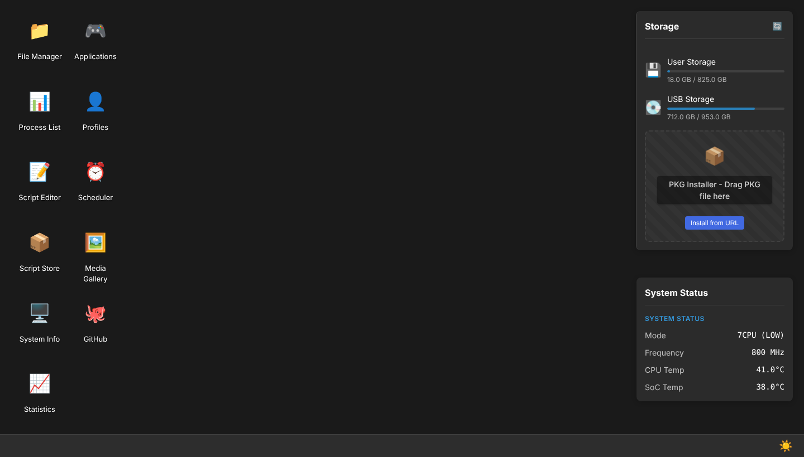
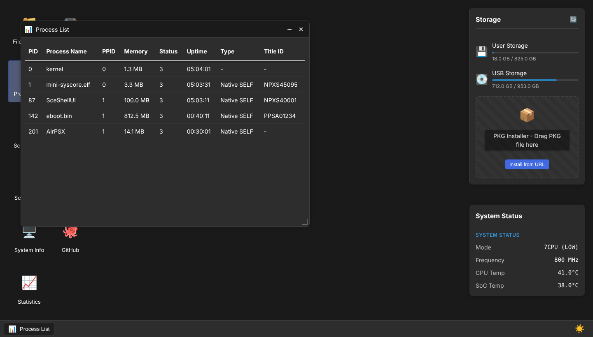

[](https://deepwiki.com/barisyild/airpsx)

## 💖 Support My Work

> I recently purchased a PlayStation 4 to work on the **AirPSX port**.  
Your donations help me cover these costs and continue developing projects like **AirPSX** and my **backend framework**. 
> 
>Thank you for supporting my open-source work!

---

# AirPSX

**AirPSX** is a payload similar to AirDroid. It enables you to manage many operations related to your PlayStation 5 console through a web-based desktop environment.

> ⚠️ **Disclaimer**
>
> I AM NOT RESPONSIBLE FOR ANY DAMAGE TO YOUR CONSOLE IF SOMETHING WILL GO WRONG!
> 
> I do not accept any responsibility for misuse of the file manager, execution of malicious scripts, or any damage that may occur to the console in any case.



*Screenshots are rendered in a headless browser with sample data.*

---

## Contents

- [Features](#features)
- [Getting started](#-getting-started)
- [Using the web UI](#using-the-web-ui)
- [HTTP API](#http-api)
- [Building from source](#building-from-source)
- [Data and configuration](#data-and-configuration)
- [Project layout](#project-layout)
- [Known limitations](#known-limitations)
- [Dependencies](#-dependencies)

---

## Features

**Web desktop** (open `http://<console-ip>:1214` in any browser on the same network)

| App | What it does |
|---|---|
| File Manager | Browse, upload, download, rename and manage files on the console. Drag and drop uploads. |
| Process List | Live process table (PID, name, memory, status, uptime, type, title ID). |
| Applications | Installed games and apps, launch from the browser. |
| Profiles | User profiles with avatars, and save-data backup download. |
| Scheduler | Create tasks and run them on a timer. Scripts are RuleScript or Lua. |
| Script Editor / Script Store | Write scripts in the browser, or install and run scripts from the online store. |
| Media Gallery | Screenshots and video clips with thumbnails and streaming playback. |
| Statistics | CPU frequency and temperature history charts, with CSV export. |
| System Info | Model, firmware/SDK versions, kernel information. |
| PKG installer | Drop a `.pkg` on the storage panel, or install from a URL. |

The desktop remembers your open windows, their position and size across page refreshes.

**Automation and backend features** (HTTP API; some have no screen in the web UI yet)

- **Task triggers**: run tasks on a timer, at boot, when a game launches or closes, or when the CPU temperature passes a limit.
- **Stats and alerts**: temperature, CPU frequency and running title are logged every minute; per-title playtime; webhook alert when the console runs hot.
- **Event webhooks**: game launch/close and backup events are POSTed to a URL (Home Assistant, n8n, Discord, ...).
- **Scheduled save backups**: tar backups on an interval to USB or a mounted network share, with retention and restore.
- **Install queue**: queue several PKGs (URL, file or whole folder) and install them one after another; PKG metadata preview.
- **Resumable uploads**: chunked uploads that survive dropped connections, with pause, resume and cancel.
- **File tools**: search, batch copy/move/delete, zip/unzip, text editor and hex viewer endpoints.
- **System control**: kill a process, uninstall a title, maintenance mode that pauses everything AirPSX does by itself.
- **SELF decrypt job queue**: persistent job queue with a pluggable backend (no decryption backend is included).

See [docs/API.md](docs/API.md) for every endpoint.

---

## 🚀 Getting Started

### elfldr
- Run elfldr payload
- Linux
  - socat -t 99999999 - TCP:PS5_HOST:9021 < "airpsx.elf"

### websrv
- Download airpsx.zip from the latest [release](https://github.com/barisyild/airpsx/releases)
- Unzip the contents to the /data/homebrew/ directory in a folder named airpsx (final path should be: /data/homebrew/airpsx/).
- Start websrv from PlayStation 5 and select the airpsx application

AirPSX shows a notification with its address when it starts. Open that address (port `1214`) in a browser.

---

## Using the web UI

Double-click a desktop icon to open an app. Windows can be dragged, resized and minimized, and they reopen where you left them after a refresh. Right-click the desktop for the context menu; the sun/moon button in the taskbar switches between dark and light themes.



---

## HTTP API

Everything the web UI does goes through a JSON HTTP API on port `1214`, and you can call it yourself:

```sh
AIRPSX=http://192.168.1.50:1214

curl -s $AIRPSX/api/system/status                       # temperatures, frequency, running app
curl -s -X POST $AIRPSX/api/fs/list -H 'Content-Type: application/json' -d '{"path":"/data/"}'
curl -s $AIRPSX/api/stats/playtime                       # playtime per title
```

The full, generated reference with request formats and worked examples (resumable uploads, task triggers, webhooks, save backups, install queue) is in **[docs/API.md](docs/API.md)**.

> There is no authentication. Anyone who can reach port 1214 can use every endpoint, including the file manager and script execution. Only run AirPSX on a network you trust.

---

## Building from source

The project is Haxe compiled to C++ with a fork of hxcpp. Builds were verified on Ubuntu 24.04.

### 1. Tools

- **Haxe 4.3.7** (the CI uses the same version)
- A C/C++ toolchain for your target:
  - **PS5**: [ps5-payload-sdk](https://github.com/ps5-payload-dev/sdk/releases) (v0.44 was used). Unzip it to `/opt/ps5-payload-sdk` and set `PS5_PAYLOAD_SDK=/opt/ps5-payload-sdk`.
  - **PS4**: [OpenOrbis PS4 toolchain](https://github.com/OpenOrbis/OpenOrbis-PS4-Toolchain/releases) (v0.5.4, `toolchain-llvm-18.tar.gz`). Extract it so it ends up in `/opt/OpenOrbis/PS4Toolchain` and set `OO_PS4_TOOLCHAIN=/opt/OpenOrbis/PS4Toolchain`.
- `clang`, `lld`, `make`, `git`

### 2. Haxe libraries

`install.sh` does all of this on Debian/Ubuntu. To do it by hand:

```sh
mkdir -p ~/haxelib && haxelib setup ~/haxelib

haxelib git hxwell        https://github.com/hxwell/hxwell
haxelib git haxe-crypto   https://github.com/barisyild/haxe-crypto
haxelib git crypto        https://github.com/HaxeFoundation/crypto
haxelib git hxvm-lua      https://github.com/kevinresol/hxvm-lua
haxelib git linc_lua      https://github.com/kevinresol/linc_lua
haxelib install haxe-concurrent 5.1.5
haxelib install hscript 2.6.0       # keep 2.6.0: 2.7.0 does not compile with rulescript 0.2.0
haxelib install rulescript 0.2.0
haxelib install uuid

# hxcpp fork with the console targets
git clone https://github.com/barisyild/hxcpp --branch orbis-payload ~/haxelib/hxcpp/orbis-payload
echo orbis-payload > ~/haxelib/hxcpp/.current
(cd ~/haxelib/hxcpp/orbis-payload/tools/hxcpp && haxe compile.hxml)
```

If `haxelib install` fails with `file_open` errors (old haxelib versions do not follow the lib.haxe.org redirect), download the zip from `https://haxelib-files.haxe.org/files/3.0/<name>-<x,y,z>.zip` and run `haxelib install <file>.zip`.

### 3. Build

```sh
# PS5 (release build)
export PS5_PAYLOAD_SDK=/opt/ps5-payload-sdk
haxelib run hxwell build cpp -hxml prospero.hxml -export Export/prospero

# PS4 (the orbis.hxml target is configured as a debug build)
export OO_PS4_TOOLCHAIN=/opt/OpenOrbis/PS4Toolchain
haxelib run hxwell build cpp -hxml orbis.hxml -export Export/orbis
```

The `-export` folder must be two levels below the repository root (as in `Export/prospero`) because the toolchain files are included relatively. The result is `airpsx.elf` in the repository root (also copied to `websrv_template/`). Send it to the console with an ELF loader (see [Getting started](#-getting-started)).

Notes:

- hxwell skips regenerating C++ when its source hash is unchanged. If a change does not seem to take effect, delete `Export/<target>/HxWell.hash`.
- `global.hxml` defines `release` for every target, which compiles out the debug-only auto-exit and shows the real serial number in System Info.
- `overrides/` holds patched copies of library classes and is added to the class path **after** the libraries in `global.hxml`, so it wins. Currently it fixes a hxwell bug that dropped the last chunk of chunked HTTP responses; delete it once hxwell fixes this upstream.
- `public/` is the prebuilt web UI. It is embedded into the binary at build time.

### Develop without a console (Linux host build)

The HTTP server and most endpoints run on a normal Linux machine, which makes backend work much faster:

```sh
haxelib run hxwell build cpp -hxml linux.hxml -export Export/linux
mkdir -p /tmp/airpsx && cd /tmp/airpsx && /path/to/repo/Export/linux/HxWell
# then open http://127.0.0.1:1214
```

The build prints an error from the final rename step, but `Export/linux/HxWell` is produced and works. Console-only endpoints (processes, applications, saves, ...) are not available in this build, and data is stored under `./data/airpsx` in the working directory.

### Regenerating the API reference

```sh
python3 tools/gen_api_docs.py     # rewrites docs/API.md from src/hx/well/route/ApiRoute.hx
```

When you add a route, add a line for it to `tools/api_descriptions.json`; the script refuses to run with missing or stale entries.

---

## Data and configuration

On the console AirPSX keeps everything under `/data/airpsx/`:

| Path | Content |
|---|---|
| `app.db` | SQLite: statistics, playtime, settings (alerts, webhooks, backup schedule), upload sessions, install queue, decrypt jobs, save backups |
| `task.db` | SQLite: scheduled tasks |
| `task/<id>.log` | Task logs |
| `scripts/` | Script Store cache |
| `backups/` | Default folder for scheduled save backups |
| `decrypted/` | Output of SELF decrypt jobs |
| `tmp/`, `cache/`, `public/` | Temporary files, HTTP cache, the extracted web UI |

Settings are stored in the `settings` table and changed through the API (see `/api/stats/alert`, `/api/save/backups/config`, `/api/system/maintenance`).

---

## Project layout

| Path | Content |
|---|---|
| `src/airpsx/` | Application code: commands, scripting backends, tasks, backups, queues, utilities |
| `src/cpp/` | Haxe bindings to console libraries (kernel, installer, registry, ...) |
| `src/hx/well/handler/` | HTTP handlers, one class per endpoint |
| `src/hx/well/route/ApiRoute.hx` | The route table |
| `overrides/` | Patched copies of library classes (see above) |
| `public/` | Prebuilt web UI |
| `toolchain/`, `include*/` | Native build configuration and headers per target |
| `tools/`, `docs/` | API doc generator, API reference and screenshots |

---

## Known limitations

- **No decryption backend.** The SELF decrypt queue works but every job fails until a native backend is plugged in (`src/airpsx/decrypt/`).
- **No authentication** on the HTTP API.
- **Uploads and archives**: resumable uploads are limited to files below 2 GB; zip/unzip work in memory (64 MB per file, 256 MB total).
- **Install queue** reports `submitted` when the console accepts a package; it cannot follow the installation itself.
- PKG preview reads PS4-format packages only.
- Several features (task triggers beyond cron, backups, queues, search, text/hex view) have API endpoints but no screen in the web UI yet.
- Firmware compatibility is not tracked in this repository. Check the release notes and the loader you use.

---

## 📦 Dependencies

* [hxcpp fork](https://github.com/barisyild/hxcpp/tree/orbis-payload)
* [hxwell](https://github.com/hxwell/hxwell)
* [rulescript](https://github.com/Kriptel/RuleScript)
* [hscript](https://github.com/HaxeFoundation/hscript) 2.6.0
* [linc_lua](https://github.com/kevinresol/linc_lua)
* [hxvm-lua](https://github.com/kevinresol/hxvm-lua)
* [uuid](https://github.com/flashultra/uuid)
* [haxe-crypto fork](https://github.com/barisyild/haxe-crypto)
* [haxe-concurrent](https://github.com/vegardit/haxe-concurrent)
* [ps5-payload-sdk](https://github.com/ps5-payload-dev/sdk) (PS5) and [OpenOrbis PS4 toolchain](https://github.com/OpenOrbis/OpenOrbis-PS4-Toolchain) (PS4)

---

## 🙏 Special Thanks

* [LightningMods](https://github.com/LightningMods) — [PS4-daemon-writeup](https://github.com/LightningMods/PS4-daemon-writeup)
* [Hugh Sanderson](https://github.com/hughsando) — [hxcpp](https://github.com/HaxeFoundation/hxcpp)
* [m0rkeulv](https://github.com/m0rkeulv) — [intellij-haxe](https://github.com/HaxeFoundation/intellij-haxe)
* [Feyzee61](https://github.com/Feyzee61)
---
